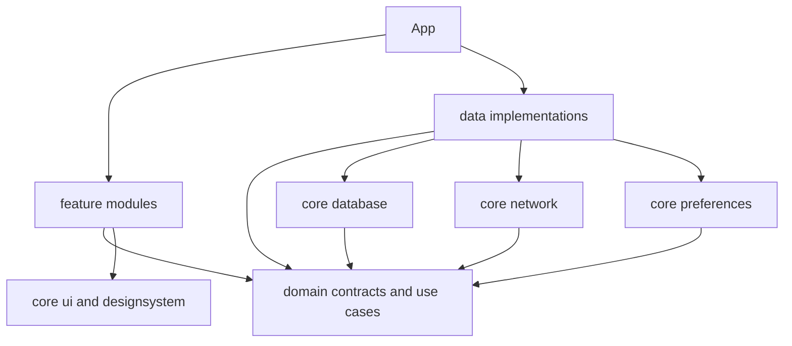

# Архитектура Tormang

Tormang — самостоятельная реализация Android-читалки. Код, логотип и оформление Mihon/Tachiyomi не копировались.

## Модули и зависимости

```text
app/                     Application, Hilt, навигация, интеграционные UI-тесты
core/
  common/                JVM: хеширование ID, распаковка архивов, ошибки
  database/              Android: Room, DAO, индексы, экспорт схем
  network/               Android: OkHttp, Retrofit, официальный xkcd API
  preferences/           Android: DataStore
  designsystem/          Compose: палитры, размеры, формы, типографика, RU/EN ресурсы
  ui/                    Compose: общие компоненты, обработка действий ViewModel
feature/
  library/ browse/ manga/ reader/ downloads/
  history/ updates/ settings/ tracking/ backup/
domain/
  src/main/kotlin/app/tormang/domain/
    model/               независимые сериализуемые модели
    repository/          интерфейсы, MangaSource, планировщик
    usecase/             фильтрация, прогресс, валидация копий
data/
  src/main/kotlin/app/tormang/data/
    local/               скачивание, SAF, WorkManager
    remote/              xkcd, Open Catalog, LocalSource, реестр
    repository/          реализации, транзакции, backup, Hilt bindings
```

Всего 19 Gradle-модулей. Общие модели находятся в `domain/model`; отдельного дублирующего `core/model` нет. `data/local`, `data/remote` и `data/repository` — пакеты внутри модуля `data`, а не пустые Gradle-проекты.



UI обращается только к ViewModel; ViewModel — к контрактам domain. Room и Retrofit недоступны экранам. Hilt связывает реализации. `Flow` доставляет изменения хранилищ; Compose подписывается с учётом lifecycle. Фильтрация и правила чтения — независимые JVM-функции.

## Данные и согласованность

Room хранит книги, главы, категории, историю, новые главы, очередь, страницы, дневник и регистрации источников. Типизированные JSON-поля сохраняют метаданные; поля ID, принадлежности библиотеке, номера, read и времени чтения доступны SQL и индексам. Непрочитанные и последняя глава агрегируются SQL-запросом, а не декодированием всех глав.

Обновление источника объединяет метаданные с пользовательскими состояниями внутри транзакции. Оно не перезаписывает позицию, категории и избранное. Идентичный ответ источника не создаёт повторные обновления. Завершённые серии исключены из периодического обновления; ручное обновление карточки работает всегда.

История и прогресс записываются транзакционно. При очистке истории позиции остаются. Приватный режим отключает только историю. В читалке запись позиции происходит после успешного отображения изображения текущей страницы.

## Источники

`MangaSource` унифицирует поиск, выдачи, метаданные, главы и страницы. Встроенный xkcd обращается к официальному JSON API с максимум тремя одновременными запросами метаданных. LocalSource читает импортированные пользовательские архивы. Open Catalog подключает HTTPS JSON-каталоги, декларирующие лицензию. Сторонний исполняемый код не загружается.

Добавление программного адаптера требует реализации интерфейса и регистрации в `Sources`, но не изменения библиотеки, читалки или загрузок. Обязательные методы присутствуют у каждого адаптера; реальные ограничения выдач отражены в capabilities и UI. xkcd не предоставляет рейтинга популярности: приложение его не выдумывает.

## Загрузки и фоновые задачи

Одна уникальная цепочка WorkManager обрабатывает очередь последовательно. Состояние хранится в Room. Пауза/отмена проверяются между страницами и во время передачи данных. Готовые страницы сохраняются отдельно; `.part` удаляется после прерывания. При перезапуске продолжаются незавершённые задания, готовые страницы используются повторно. Обновление статуса транзакционно проверяет, что пользователь не приостановил или удалил задание.

Файлы сохраняются во внутреннюю папку или в выбранное дерево SAF. Разрешение сохраняется системой; широкое разрешение на всё хранилище не требуется. Потеря доступа отображается как ошибка. Частичный локальный список не подменяет полный список страниц главы.

Загрузчики работают ограниченными по времени проходами; WorkManager повторяет продолжение. Обновление библиотеки планируется раз в 12 часов при наличии сети и достаточного заряда. Android может сдвинуть фактическое время. Между сериями выдерживается пауза 1,5 секунды. Уведомления зависят от пользовательского и системного разрешений.

## Читалка и память

Вертикальный и горизонтальный Pager, RTL/LTR, непрерывный LazyColumn для вебтунов. Компонуются видимые страницы; Coil предварительно загружает только две следующие. Декодирование ограничено целевым размером; memory cache — 18% доступной приложению памяти, disk cache — 128 МБ. HTTP cache — 32 МБ. При выходе восстанавливаются яркость, ориентация и системные панели.

Читалка использует double tap и pinch zoom до 5×, ограниченный pan, навигацию по страницам, fullscreen и переход глав. Это масштабирование декодированного изображения: тайлового декодера для постеров сверхвысокого разрешения пока нет.

## Резервные копии

Версия формата 1, UTF-8 JSON, ограничение входного файла 32 МБ. До показа предпросмотра проверяются версия, уникальность ID, связи, состояния и размер. Восстановление метаданных — транзакционное объединение; совпадающие записи заменяются, остальные сохраняются. DataStore обновляется после транзакции: сбой процесса между этими операциями может оставить прежние настройки при восстановленной библиотеке. Повторный импорт безопасен.

Локальные пути изображений и разрешения SAF на другое устройство не переносятся. Копия не содержит скачанные страницы, архивы или токены сторонних сервисов. Системное автоматическое копирование отключено; экспорт контролирует пользователь.

## Design system

Оригинальная палитра: лесной зелёный, мягкие нейтральные поверхности, спокойные акценты. Системная/light/dark/AMOLED темы, динамические цвета Android 12+. Сетка от 148 dp адаптируется к ширине, навигационная панель заменяет нижнюю навигацию от 840 dp. Шкала отступов 4/8/16/24/32 dp, формы 8/16/24 dp. Material 3 обеспечивает стандартные состояния, диалоги и доступные зоны нажатий. Reader chrome минимален и скрывается по касанию.
